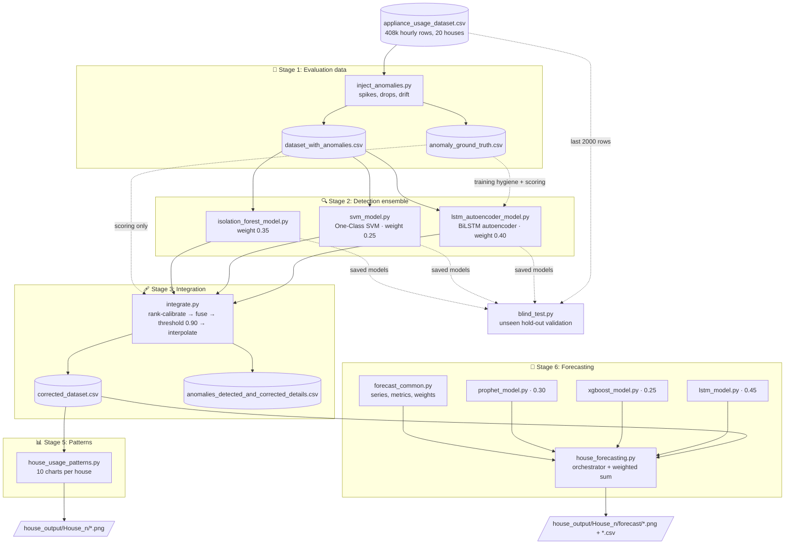
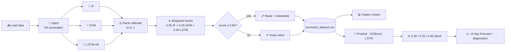

# ⚡ Electricity Consumption: Anomaly Detection, Cleaning & Forecasting

An end-to-end machine-learning pipeline that takes **hourly appliance-level electricity data for 20 households**, finds and repairs faulty sensor readings, explains *how* each household uses power, and **forecasts the next 14 days of demand**.


---

## 📑 Table of Contents
1. [Project Overview](#-project-overview)
2. [Dataset](#-dataset)
3. [Architecture](#-architecture)
4. [Workflow](#-workflow)
5. [Stage 1 – Anomaly Injection](#-stage-1--anomaly-injection)
6. [Stage 2 – Anomaly Detection (3-model ensemble)](#-stage-2--anomaly-detection-3-model-ensemble)
7. [Stage 3 – Fusion & Correction](#-stage-3--fusion--correction)
8. [Stage 4 – Blind Test](#-stage-4--blind-test)
9. [Stage 5 – Usage-Pattern Analysis](#-stage-5--usage-pattern-analysis)
10. [Stage 6 – Forecasting (Prophet + XGBoost + LSTM)](#-stage-6--forecasting-prophet--xgboost--lstm)
11. [Project Structure](#-project-structure)
12. [Getting Started](#-getting-started)
13. [Outputs](#-outputs)
14. [Design Decisions: the "why" in one table](#-design-decisions-the-why-in-one-table)
15. [Limitations & Future Work](#-limitations--future-work)

---

## 🎯 Project Overview

Smart-meter data is messy: sensors spike, drop to zero, or drift. Forecasting on dirty data gives dirty forecasts. This project solves the problem in order:

| Question | Answer produced by |
|---|---|
| 🔍 Which readings are faulty? | Isolation Forest + One-Class SVM + LSTM Autoencoder |
| 🩹 What should they have been? | Linear temporal interpolation |
| 📊 When and how does each house use power? | 10 pattern charts per house |
| 🔮 What will the next 14 days look like? | Weighted ensemble of Prophet, XGBoost and LSTM |

**Why this order?** Cleaning comes first because every downstream step (charts, forecasts) is built from `corrected_dataset.csv`, never from the raw data. Both `house_usage_patterns.py` and `house_forecasting.py` run the cleaning pipeline automatically if the corrected file doesn't exist yet.

---

## 🗂️ Dataset

`appliance_usage_dataset.csv`: **408,480 rows × 10 columns**

| Column | Description |
|---|---|
| `timestamp` | Hourly, `01-01-2023 00:00` → `30-04-2025 23:00` |
| `house_id` | `House_1` … `House_20` |
| `season` | winter / summer / rainy / autumn |
| `festival` | Indian festivals (Makar Sankranti, Holi, Diwali, Navratri, …) or `None` |
| `ac, fridge, lights, fans, washing_machine, tv` | Hourly usage per appliance |

**Why festivals and seasons are included:** household demand in India swings with weather (AC in summer) and celebrations (lights and appliances on Diwali). These are the signals the forecasting models are explicitly given.

---

## 🏗️ Architecture



**Design principle:** each stage is its own module with a single responsibility and communicates through files (CSV / pickle / `.keras`). This makes every stage independently runnable, cacheable and debuggable, and `integrate.py` reuses saved prediction files so re-runs are instant.

---

## 🔄 Workflow



---

## 💉 Stage 1 – Anomaly Injection

**File:** `inject_anomalies.py` → `dataset_with_anomalies.csv`, `anomaly_ground_truth.csv`

**What:** Corrupts ~5% of rows with three realistic fault types and records exactly which rows were touched.

| Type | Share | How | Mimics |
|---|---|---|---|
| ⬆️ **Spike** | 40% | `value + (5–10) × std` in one random appliance | Power surge / meter glitch |
| ⬇️ **Drop** | 30% | Appliance reading set to `0` | Sensor disconnect |
| 〰️ **Drift** | 30% | `+(3–5) × std` held for 5 consecutive hours | Calibration shift |

**Why:** the real dataset has no labels. Without knowing which rows are wrong you can't measure whether a detector works. Injecting known faults gives a **ground truth** for precision / recall / F1. A fixed seed (`42`) makes this reproducible.

---

## 🔍 Stage 2 – Anomaly Detection (3-model ensemble)

Three detectors that *fail differently*, so their mistakes don't overlap.

### 🌲 Isolation Forest, `isolation_forest_model.py`
- 200 trees, `contamination=0.05`, on standardised features.
- **How:** anomalies are easy to isolate with few random splits → short path length → high anomaly score.
- **Why:** fast, scales to 400k rows, no distributional assumptions. Great at **spikes**.

### 🎯 One-Class SVM, `svm_model.py`
- RBF kernel, `nu=0.05`, PCA applied if >8 features.
- **Trained on a 10,000-row subsample**, then scores *all* rows.
- **How:** learns a boundary around "normal" in feature space.
- **Why subsample:** SVM training is roughly O(N²); a 10k sample keeps it tractable with little loss since the normal region is well-covered.

### 🧠 Bidirectional LSTM Autoencoder, `lstm_autoencoder_model.py`
- Windows of 10 hours → BiLSTM encoder → bottleneck → BiLSTM decoder, with a **residual skip connection** (`output = input projection + learned residual`).
- **Preprocessing:** `log1p` (tames zero-inflated usage) → `RobustScaler` (resists outliers).
- **Scoring:** *peak* (max) absolute reconstruction error across the window, then averaged back onto each row; top 5% flagged.
- Early stopping + learning-rate scheduling.

**Why these choices matter:**
| Choice | Reason |
|---|---|
| Train **only on clean windows** (ground-truth-contaminated windows dropped) | An autoencoder must learn *normal* behaviour. Training on anomalies teaches it to reconstruct them too, giving inflated accuracy and weak separation. |
| **Max** error instead of mean | A spike touches 1 of 6 appliances in 1–5 of 10 timesteps; averaging dilutes it below detectability. |
| Bidirectional + sequence model | Catches **drift** and temporal-context anomalies that point-wise models (IF, SVM) cannot see. |
| Residual skip | Lets the network preserve baseline power levels easily and focus on the residual. |

> ⚠️ Using ground truth to filter autoencoder training windows is acceptable for this benchmark, but in production you'd use a rolling-median pre-filter or train on a vetted clean period instead.

---

## ⚖️ Stage 3 – Fusion & Correction

**File:** `integrate.py`

1. **Calibrate:** every model's raw score is converted to an empirical-CDF rank in `[0, 1]` (`calibrate_to_probability`).
   *Why:* IF scores, SVM margins and reconstruction errors live on incomparable scales; ranks put them on one.
2. **Fuse:** `final = 0.35·IF + 0.25·SVM + 0.40·LSTM`
   *Why these weights:* LSTM gets the most because it sees temporal context; IF is strong and fast; SVM is the weakest/most subsampled.
3. **Threshold at 0.90:** the script prints precision / recall / F1 for thresholds 0.60 → 0.90 so the trade-off is visible. A high cutoff favours **precision**, because wrongly "fixing" a good reading damages the data, while a missed anomaly costs less.
4. **Correct:** flagged values are set to `NaN`, then **linearly interpolated in time** per appliance (median fallback at the edges).
   *Why interpolation:* usage is smooth hour to hour, it's simple, explainable and creates no leakage.
5. **Audit:** `anomalies_detected_and_corrected_details.csv` lists every flagged row with the three model scores, the corrupted value and the corrected value, so **nothing is changed silently**.

It also prints a per-model comparison table (accuracy, precision, recall, F1, ROC-AUC, TP/FP/FN) against the ground truth.

---

## 🧪 Stage 4 – Blind Test

**File:** `blind_test.py`

**What:** takes the **last 2,000 rows** of the original data, injects fresh anomalies (40 spikes, 30 full-row drops, 6 drift bursts × 5 rows) with a *different* seed, and scores them with the **already-trained saved models**.

**Why:** the main evaluation uses the same data the models were fitted on. A blind test checks that detection generalises to rows the models never saw, with faults they never saw.

Differences from the main fusion (because absolute scoring is needed with no full-dataset ranks available):
- Scores are standardised against the **training score distribution** (z-score → sigmoid) rather than ranked.
- Weights are re-tuned (`0.65 IF, 0.10 SVM, 0.25 LSTM`) and blended with the **peak** model confidence (`0.7·weighted + 0.3·max`) so an anomaly flagged strongly by *any one* model isn't averaged away.
- Threshold `0.61`.

Outputs: `pseudo_blind_test_dataset.csv`, `blind_test_corrected_dataset.csv`, `blind_test_anomalies_audit.csv`. Run it to see accuracy / precision / recall / F1 / confusion matrix on your machine.

> ⚠️ The blind-test weights and threshold were tuned with knowledge of the injected fault types, so treat the results as an *optimistic* estimate.

---

## 📊 Stage 5 – Usage-Pattern Analysis

**File:** `house_usage_patterns.py` → `house_output/House_<n>/` (10 charts)

| # | Chart | Question answered |
|---|---|---|
| 01 | Seasonal total usage | Which season costs the most? |
| 02 | Seasonal appliance breakdown | Which appliance drives each season? |
| 03 | Peak-hour appliance | What dominates the peak hour? |
| 04 | Hourly appliance pattern | What does a typical day look like? |
| 05 | Day vs night | How much usage is daytime? |
| 06 | Weekday vs weekend | Does the routine change? |
| 07 | Hour × weekday heatmap | When exactly are the peaks? |
| 08 | Monthly trend | Long-run growth / seasonality |
| 09 | Appliance contribution share | Who uses what share? |
| 10 | Festival vs normal days | Do festivals raise consumption? |

**Why:** these are the exploratory insights that justify the forecasting features (hour-of-day, weekday, season, festival).

A simpler first-pass script, `analyze_electricity_usage.py`, samples 3–4 houses and writes peak-hour summaries to `analysis_output/`.

---

## 🔮 Stage 6 – Forecasting (Prophet + XGBoost + LSTM)

**Files:** `house_forecasting.py` (orchestrator), `prophet_model.py`, `xgboost_model.py`, `lstm_model.py`, `forecast_common.py`

**Setup:** the hourly total-usage series for one house is gap-filled by interpolation. The **last 14 days are held out** as a backtest set; the models then forecast the **next 14 days**.

| Model | Config | Strength |
|---|---|---|
| 📈 **Prophet** | Daily + weekly + yearly seasonality, each festival as a *holiday*, `is_weekend` regressor | Interpretable trend, seasonality and festival effects |
| 🌳 **XGBoost** | Calendar (hour, weekday, month, season, weekend) + lags 1/24/168h + rolling means 24/168h; 300 trees, depth 6 | Learns non-linear interactions; gives feature importance |
| 🧠 **LSTM** | 48h lookback + sin/cos hour & weekday channels; LSTM(64) → Dropout → Dense(32) → Dense(1); early stopping | Captures sequential dynamics |

**Why sin/cos time encoding?** Hour 23 and hour 0 are neighbours; raw integers say they're far apart. Cyclical encoding fixes that without needing a week-long window.

**Why a 48h LSTM window?** Keeps training fast; weekly pattern is supplied through the weekday channels.

**Multi-step forecasting:** XGBoost and LSTM predict **recursively**: each prediction becomes the next step's lag input.

### ⚖️ Weighted ensemble

```
Final = 0.30 × Prophet + 0.45 × LSTM + 0.25 × XGBoost
```
- **Why an ensemble?** Different model families make different errors; blending reduces variance.
- **Why non-negative weights summing to 1?** The blend can never leave the range of the individual predictions, so a model-predicted usage can't turn negative.

### 🩺 Overfitting diagnostics
For every model (and the blend) the pipeline reports RMSE / MAE / MAPE on train **and** test, plus the **overfit gap** `(test RMSE − train RMSE) / train RMSE`:

| Gap | Verdict |
|---|---|
| ≤ 10% | ✅ generalizes well |
| 10–25% | 🟡 mild gap |
| > 25% | 🔴 overfitting risk |

**Example (House 2, 14-day backtest, from `model_diagnostics.csv`):**

| Model | Test RMSE | Test MAPE | Overfit gap | Verdict |
|---|---|---|---|---|
| Prophet | 0.369 | 9.55% | −2.0% | ✅ generalizes well |
| XGBoost | 0.365 | 9.21% | +18.0% | 🟡 mild gap |
| LSTM | 0.370 | 9.38% | −2.1% | ✅ generalizes well |

### 📈 Forecast outputs
Backtest vs actual · model comparison · overfitting diagnostics · 14-day future trend · **load-management view** · seasonal pattern · weekday/weekend effect · festival effect · XGBoost feature importance · LSTM loss curve, plus `backtest_predictions.csv`, `future_forecast.csv`, `festival_effect.csv`, `model_diagnostics.csv`.

---

## 📁 Project Structure

```
├── appliance_usage_dataset.csv        # raw hourly data (20 houses)
├── inject_anomalies.py                # Stage 1
├── isolation_forest_model.py          # Stage 2a
├── svm_model.py                       # Stage 2b
├── lstm_autoencoder_model.py          # Stage 2c
├── integrate.py                       # Stage 3: fuse, correct, audit
├── blind_test.py                      # Stage 4: unseen-data validation
├── house_usage_patterns.py            # Stage 5: 10 charts per house
├── forecast_common.py                 # shared constants, metrics, ensemble
├── prophet_model.py                   # Stage 6a
├── xgboost_model.py                   # Stage 6b
├── lstm_model.py                      # Stage 6c
├── house_forecasting.py               # Stage 6: orchestrator (patterns + forecast)
├── analyze_electricity_usage.py       # quick peak-hour analysis
├── requirements.txt
├── corrected_dataset.csv              # ← cleaned data (generated)
├── anomalies_detected_and_corrected_details.csv   # audit log (generated)
├── analysis_output/                   # peak-hour summaries & charts
└── house_output/House_<n>/            # pattern charts + forecast/ sub-folder
```

---

## 🚀 Getting Started

```powershell
# 1. Clone and enter
git clone https://github.com/Priyanshu-Jha-04/Electricity-Consumption-and-Forecasting.git
cd Electricity-Consumption-and-Forecasting

# 2. Environment
python -m venv .venv
.venv\Scripts\activate
pip install -r requirements.txt
pip install scipy            # used by integrate.py

# 3. Build the cleaned dataset (inject → detect → fuse → correct)
python inject_anomalies.py
python isolation_forest_model.py
python svm_model.py
python lstm_autoencoder_model.py      # slowest step (TensorFlow)
python integrate.py

# 4. (optional) validate on unseen data
python blind_test.py

# 5. Analyse and forecast a house (1–20)
python house_usage_patterns.py --house 7
python house_forecasting.py --house 7

# Quick peak-hour analysis on random houses
python analyze_electricity_usage.py --houses 3 --seed 7
```

Each model script can also be run alone for a sanity check, e.g. `python prophet_model.py --house 5`.

> 💡 Running `house_forecasting.py` on its own is enough: it triggers `integrate.py` automatically if `corrected_dataset.csv` is missing.

---

## 📦 Outputs

| Output | Location |
|---|---|
| Cleaned dataset | `corrected_dataset.csv` |
| Anomaly audit log | `anomalies_detected_and_corrected_details.csv` |
| Model comparison / training curves | `model_comparison.png`, `training_loss_accuracy_curve.png` |
| Per-house usage charts | `house_output/House_<n>/*.png` |
| Per-house forecasts | `house_output/House_<n>/forecast/` |

---

## 🧭 Design Decisions: the "why" in one table

| Decision | Why |
|---|---|
| Inject synthetic anomalies | Real data has no labels; ground truth enables objective metrics |
| Three different detectors | Tree, boundary and sequence models catch different fault types |
| Rank calibration before fusion | Puts incomparable scores on the same 0–1 scale |
| High threshold (0.90) | Favour precision: avoid "fixing" valid readings |
| Interpolate rather than delete | Keeps the hourly time grid intact for time-series models |
| Audit CSV | Every change is traceable and reversible |
| Blind test on held-out rows | Verifies generalisation, not memorisation |
| Clean-only autoencoder training | Prevents the model learning to reconstruct anomalies |
| Time-based train/test split (last 14 days) | Random splits leak the future into training |
| Overfit-gap report | Makes generalisation visible per model |
| Weighted ensemble | Averages out model-specific errors |

---

## ⚠️ Limitations & Future Work

- 🧪 **Synthetic evaluation:** detection is scored on injected anomalies, which may be easier or different from real faults.
- 🧑‍🏫 **Ground-truth leakage:** the autoencoder's clean-window filter uses labels; a production version needs a label-free alternative.
- ⚖️ **Hand-set weights:** ensemble weights (`0.35/0.25/0.40`, `0.30/0.45/0.25`) are fixed, not learned. A stacking model or weights tuned on validation error would be more principled.
- 🔁 **Recursive forecasting** accumulates error over a 14-day (336-step) horizon.
- 🏠 **Per-house models:** each house is modelled independently; a global model with house embeddings could share information.
- 🔭 **Ideas:** SHAP explanations, prediction intervals for the ensemble, a Streamlit dashboard, carbon-aware load-shifting recommendations, real smart-meter data.

---

## 👤 Author

**Priyanshu Jha**: [GitHub](https://github.com/Priyanshu-Jha-04)

⭐ If you found this useful, consider starring the repo!
